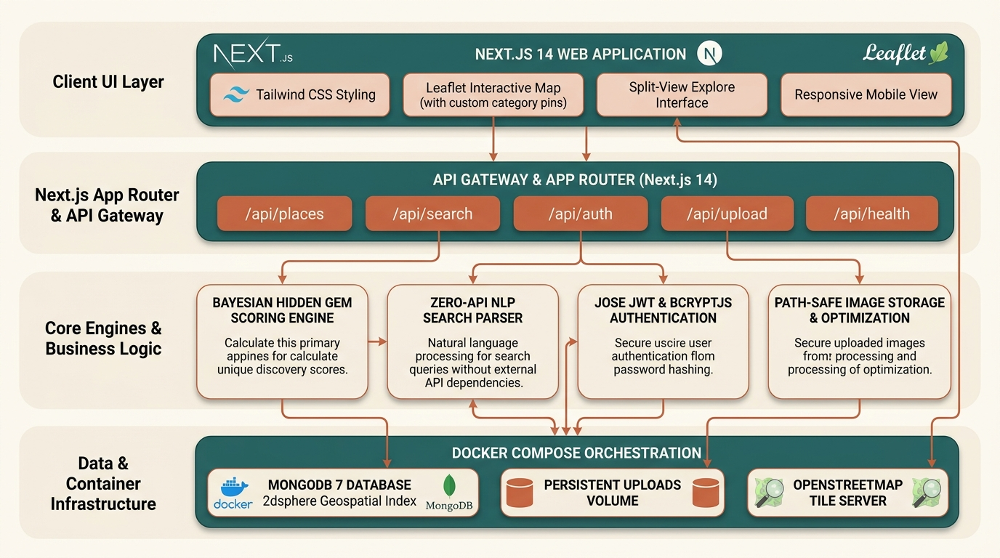

# 💎 HiddenGems — Visual, Map-First City Discovery Platform

> **Hackathon Theme:** Travel & Tourism / Smart City / Web & UI Innovation  
> **Target Audience:** College students, budget travelers, backpackers, and curious urban discoverers.

---

## 🌟 Executive Summary & Problem Solved

Popular travel platforms only surface expensive, commercialized tourist attractions and sponsored listings. Students and budget travelers struggle to find reliable information on inexpensive food, quiet study spots, peaceful viewpoints, and authentic thrift markets in their city.

**HiddenGems** is a map-first discovery platform built to uncover authentic, affordable, and uncrowded local spots while enabling the community to build, verify, and govern the database without commercial bias.

---

## 🚀 Key Features

1. **Map-First Visual Split View (`/explore`)**:
   - Interactive OpenStreetMap & Leaflet with custom category pins, hover highlighting, and preview popups.
   - Mobile-responsive with dedicated List-only / Map-only view toggle.
2. **Natural-Language Search Bar (`lib/nlpSearch.ts`)**:
   - Parses complex queries like `"cheap quiet place to study near Andheri under 150"` into interactive, removable filter chips without paid AI APIs.
3. **Multi-Faceted Filtering & Geolocation**:
   - Category chips (Cheap Food, Study Spaces, Scenic Viewpoints, Thrift Markets, Chill Hangouts).
   - Budget slider (₹0 – ₹500/person).
   - Distance radius slider with browser GPS geolocation and manual area fallback.
   - Vibe tags (`#quiet`, `#scenic`, `#aesthetic`, `#late-night`, `#solo-friendly`, etc.).
   - Verified amenities (`Wi-Fi`, `Power Outlets`, `Seating`, `Washroom`, `AC`).
   - "Open Now" toggle and multi-criterion sorting.
4. **Bayesian Hidden Gem Score (`0 - 100`)**:
   - Calculated server-side on every vote, visit, or review.
   - Interactive breakdown modal on the place detail page explaining how the score is calculated.
5. **Trust, Moderation & Anti-Spam**:
   - Rate limiting: Max 5 submissions per user per day.
   - Enforced single vote and visit confirmation per user per place with unique database compound indexes.
   - Automated status progression: Places start as `"pending"` and automatically upgrade to `"community verified"` once they receive 3 distinct physical visits or 5 upvotes.
   - In-app reporting flow with dedicated `/admin` moderation queue.
6. **Curated Trails & Shared Lists (`/lists/[id]`)**:
   - Create named itineraries (e.g. *"Weekend Under ₹300"*).
   - Public shareable links displaying stops in order with route maps and total budget calculation.
7. **Local Image Upload Pipeline (`lib/storage.ts`)**:
   - Independent of third-party cloud storage (No Cloudinary).
   - Files saved to persistent `UPLOAD_DIR` outside the public folder.
   - Magic byte signature validation (JPEG, PNG, WebP) with 5MB limit.
   - Served dynamically via `/api/uploads/[filename]` with path traversal protection and cache headers.
   - Clean category gradient placeholder when no images are provided.

---

## 🧮 The Hidden Gem Score Formula

The Hidden Gem Score is an anti-tourist-trap algorithm that rewards obscurity, authentic ratings, and low prices while penalizing commercial tourist crowds:

$$\text{Score} = 100 \times (0.35 \times \text{ratingNorm} + 0.20 \times \text{obscurityNorm} + 0.20 \times \text{affordabilityNorm} + 0.15 \times \text{upvoteNorm} + 0.10 \times \text{verifiedNorm})$$

### Component Breakdown
- **$\text{ratingNorm}$** = Bayesian average $\left(\frac{\text{avgRating} \times \text{reviews} + 3.5 \times 3}{\text{reviews} + 3}\right) / 5$ (shrinks small samples toward a neutral prior of 3.5 to prevent fake review spam).
- **$\text{obscurityNorm}$** = $1 - \min\left(\frac{\text{reviewCount}}{50}, 1\right)$ (fewer commercial reviews indicates higher hidden authenticity).
- **$\text{affordabilityNorm}$** = $1 - \min\left(\frac{\text{pricePerPerson}}{500}, 1\right)$ (rewards student budget affordability below ₹500).
- **$\text{upvoteNorm}$** = $\min\left(\frac{\text{upvotes}}{30}, 1\right)$ (community approval).
- **$\text{verifiedNorm}$** = $\min\left(\frac{\text{distinctVisits}}{5}, 1\right)$ (physical on-the-ground proof).

---

## 🛠️ Tech Stack

- **Framework**: Next.js 14+ (App Router, TypeScript) with `output: "standalone"`
- **Styling**: Tailwind CSS with custom travel color palette, dark mode, and glassmorphism
- **Database**: MongoDB 7 + Mongoose with `2dsphere` geospatial indexing
- **Mapping**: Leaflet + `react-leaflet` with OpenStreetMap (dynamic SSR-safe import)
- **Authentication**: `bcryptjs` for hashing + `jose` for HS256 JWT in `httpOnly` secure cookies
- **Icons & Motion**: `lucide-react` + `framer-motion`
- **Validation**: Zod schema validation on all inputs and API routes
- **Containerization**: Multi-stage Dockerfile (`node:20-alpine`) + Docker Compose

---

## 🐳 Running with Docker (Recommended)

Start the entire application, database, and persistent storage with a single command:

### 1. Build and Start Containers
```bash
docker compose up --build -d
```
*Or using the Makefile shortcut:*
```bash
make up
```

### 2. Seed the Database
Populates ~26 sample Mumbai places across Bandra, Fort, Colaba, Andheri, Powai, Matunga, and 3 pre-configured demo users:
```bash
docker compose --profile seed run --rm seed
```
*Or using Makefile:*
```bash
make seed
```

### 3. Open the App
Visit: **[http://localhost:3000](http://localhost:3000)**

### 4. Docker Health & Logs
```bash
# View real-time application logs
docker compose logs -f app

# Inspect container health status
docker compose ps
```

### 5. Stop Containers
```bash
docker compose down
```

---

## 💻 Running Without Docker (Local Development)

If you prefer to run locally using Node.js / Bun and a local MongoDB instance (or MongoDB Atlas):

### 1. Install Dependencies
```bash
npm install
# or: bun install
```

### 2. Configure Environment Variables
Create `.env.local`:
```bash
cp .env.example .env.local
```
Set `MONGODB_URI` to your local MongoDB instance or Atlas connection string:
```env
MONGODB_URI=mongodb://127.0.0.1:27017/hiddengems
JWT_SECRET=hiddengems-super-secure-jwt-secret-key-32-chars-long!
ADMIN_EMAIL=admin@hiddengems.local
UPLOAD_DIR=./uploads
NEXT_PUBLIC_DEFAULT_CITY=Mumbai
NEXT_PUBLIC_DEFAULT_LAT=19.0760
NEXT_PUBLIC_DEFAULT_LNG=72.8777
PORT=3000
```

### 3. Seed Database
```bash
npm run seed
```

### 4. Start Next.js Dev Server
```bash
npm run dev
```
Open **[http://localhost:3000](http://localhost:3000)** in your browser.

---

## 🔑 Pre-Configured Demo Accounts

For immediate evaluation, the seed script provisions three accounts with different roles and reputation tiers:

| Role | Email | Password | Contributor Badge & Reputation |
| :--- | :--- | :--- | :--- |
| **Admin** | `admin@hiddengems.local` | `AdminPass123!` | 🏅 Local Guide (280 pts) |
| **Explorer** | `priya.explorer@gmail.com` | `Password123!` | 🏅 Explorer (85 pts) |
| **Student** | `rohan.student@college.edu` | `Password123!` | 🏅 Newcomer (35 pts) |

*(A 1-click test fill button is also available directly on `/login`.)*

---

## 📂 Project Architecture



```
techformer/
├── app/
│   ├── api/
│   │   ├── admin/places/route.ts       # Moderation approvals & removals
│   │   ├── admin/reports/route.ts      # Abuse reports inspection
│   │   ├── auth/                       # login, register, logout, me
│   │   ├── health/route.ts             # Health check for Docker (GET /api/health)
│   │   ├── lists/                      # Curated trail CRUD & share
│   │   ├── places/                     # Places geo-filter, create, detail
│   │   │   └── [idOrSlug]/             # vote, visit, reviews, report, save
│   │   ├── search/route.ts             # Natural-language regex search parser
│   │   ├── upload/route.ts             # Local multi-image upload
│   │   └── uploads/[filename]/route.ts # Secure streaming route from UPLOAD_DIR
│   ├── explore/page.tsx                # Split-view discovery map & sidebar
│   ├── places/
│   │   ├── [slug]/page.tsx             # Detail view, reviews, score tooltip
│   │   └── new/page.tsx                # Multi-step creation with map pin picker
│   ├── lists/[id]/page.tsx             # Public shareable trails with route maps
│   ├── profile/page.tsx                # User badges, reputation, saved spots
│   ├── admin/page.tsx                  # Admin dashboard
│   ├── layout.tsx & globals.css        # Root layout, fonts, dark mode, Leaflet
│   └── page.tsx                        # Landing page (Hero, Trending, Under ₹100)
├── components/
│   ├── AuthContext.tsx                 # Global session & dark mode provider
│   ├── FilterSidebar.tsx               # Category, budget, GPS radius filters
│   ├── Footer.tsx & Navbar.tsx         # Responsive navigation & brand footer
│   ├── NaturalSearchBar.tsx            # NLP query input with removable chips
│   ├── PlaceCard.tsx                   # Photo-forward card with price & score badge
│   └── Map/
│       ├── DynamicMap.tsx              # Leaflet dynamic ssr:false wrapper
│       ├── InteractiveMap.tsx          # Custom emoji category pins & popups
│       └── LocationPickerMap.tsx       # Tap-on-map coordinate picker
├── lib/
│   ├── auth.ts                         # jose JWT & bcryptjs password hashing
│   ├── db.ts                           # MongoDB cached connection pool
│   ├── hiddenGemScore.ts               # Bayesian Hidden Gem algorithm
│   ├── nlpSearch.ts                    # Natural-language query parser
│   ├── storage.ts                      # Local upload abstraction & magic byte check
│   └── validators.ts                   # Zod schemas & spam filters
├── models/                             # User, Place, Review, Vote, Visit, List, Report
├── scripts/
│   └── seed.js                         # Plain Node.js seed script (26 Mumbai spots)
├── docker-compose.yml                  # Production-like multi-container setup
├── docker-compose.dev.yml              # Dev setup with hot reload & polling
├── Dockerfile                          # Multi-stage production build (node:20-alpine)
└── Makefile                            # CLI shortcuts (make up, make seed, etc.)
```

---

## 💾 Backing Up & Managing Docker Volumes

Docker volumes ensure that MongoDB data and user-uploaded images persist across container restarts, rebuilds, and updates:

### Volume Locations
- `hiddengems_mongo_data`: Stores MongoDB database collections.
- `hiddengems_uploads_data`: Stores user-uploaded images mounted to `/app/uploads`.

### Backup Commands
```bash
# Backup uploaded images to a local tar archive:
docker run --rm -v hiddengems_uploads_data:/data -v $(pwd):/backup alpine tar czvf /backup/uploads_backup.tar.gz -C /data .

# Backup MongoDB database:
docker run --rm -v hiddengems_mongo_data:/data -v $(pwd):/backup alpine tar czvf /backup/mongo_backup.tar.gz -C /data .
```

### Restore Commands
```bash
docker run --rm -v hiddengems_uploads_data:/data -v $(pwd):/backup alpine tar xzvf /backup/uploads_backup.tar.gz -C /data
```

---

## 🔧 Docker Troubleshooting

| Issue | Cause | Solution |
| :--- | :--- | :--- |
| **Port 3000 or 27017 in use** | Another local dev server or MongoDB instance is running. | Stop local processes (`killall node` or `brew services stop mongodb-community`) or change host port in `docker-compose.yml` (e.g. `3001:3000`). |
| **Database connection refused** | App started before MongoDB was ready. | The compose setup includes `depends_on: { condition: service_healthy }` using `mongosh ping`. If restarting, run `docker compose restart app`. |
| **Stale build cache after edits** | Docker reused previous image layers. | Run `docker compose build --no-cache && docker compose up -d`. |
| **Reset all data to clean state** | Clear volumes and re-seed from scratch. | Run `docker compose down -v && docker compose up -d --build && docker compose --profile seed run --rm seed`. |

---

## 📸 Screenshots & UI Previews

*(Placeholders for presentation screenshots)*
- **Hero & Landing Page**: `[Screenshot: Hero search & category chips]`
- **Explore Map & Split View**: `[Screenshot: Interactive map pins, category badges, and filter sidebar]`
- **Hidden Gem Score Breakdown**: `[Screenshot: Bayesian scoring tooltip with component breakdown]`
- **Add Place Location Picker**: `[Screenshot: Tap-on-map coordinate selection & local photo upload]`
- **Curated Trail Itinerary**: `[Screenshot: Ordered route map and total budget preview]`

---

## 📜 License
Open-source hackathon project built for student discovery and urban exploration.
